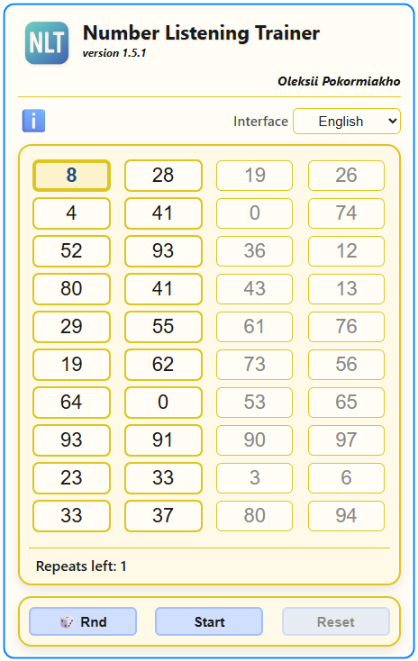

🌐 Available languages:  
[English](docs/readme/README.en.md) | [Deutsch](docs/readme/README.de.md) | [Nederlands](docs/readme/README.nl.md) | [Українська](docs/readme/README.uk.md) | [Русский](docs/readme/README.ru.md)

---

# NLT Number Listening Trainer

This is a compact, one-page application designed for learning numbers in foreign languages.  
The app employs a method of simultaneous auditory and visual perception, enabling rapid and effective memorization.

---

🌐 Available languages:  
[English](docs/readme/README.en.md) | [Deutsch](docs/readme/README.de.md) | [Nederlands](docs/readme/README.nl.md) | [Українська](docs/readme/README.uk.md) | [Русский](docs/readme/README.ru.md)
