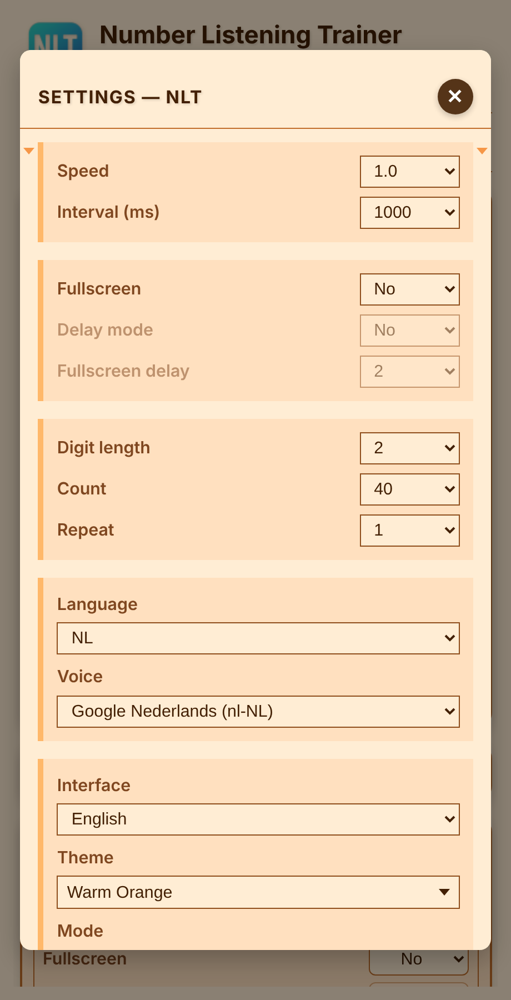

🌐 Beschikbare talen:  
[العربية](README.ar.md) | [Čeština](README.cs.md) | [Deutsch](README.de.md) | [English](README.en.md) | [Español](README.es.md) | [Français](README.fr.md) | [Italiano](README.it.md) | [Nederlands](README.nl.md) | [Polski](README.pl.md) | [Português](README.pt.md) | [Русский](README.ru.md) | [Türkçe](README.tr.md) | [Українська](README.uk.md)

---

# NLT Number Listening Trainer

Dit is een compacte, eendelige applicatie ontworpen om getallen in vreemde talen te leren.  
De app maakt gebruik van een methode van gelijktijdige auditieve en visuele waarneming, waardoor snelle en effectieve memorisatie mogelijk is.

## Functies

- Leest willekeurige getallen hardop voor en markeert elk getal op het scherm, zodat je het tegelijk hoort en ziet.
- Kies het aantal cijfers, hoeveel getallen je oefent en hoe vaak de reeks wordt herhaald.
- Stel de spreeksnelheid, de pauze tussen de getallen en de taal en stem van je apparaat in.
- De optionele schermvullende modus toont het huidige getal in grote letters (op telefoons standaard aan).
- Werkt op telefoons en computers, in 13 interfacetalen, met 10 kleurthema’s in vier modi (normaal, avond, nacht, contrast).

## Instellingen

Het instellingenvenster bevat snelheid en interval, schermvullend, aantal cijfers, aantal en herhalingen, taal en stem, interfacetaal, thema en modus, en terugzetten naar de standaardwaarden.

## Aan de slag

Open de app in je browser: https://oleksiypok.github.io/NLT/. Er hoeft niets geïnstalleerd te worden en je instellingen worden in de browser opgeslagen.

---

🌐 Beschikbare talen:  
[العربية](README.ar.md) | [Čeština](README.cs.md) | [Deutsch](README.de.md) | [English](README.en.md) | [Español](README.es.md) | [Français](README.fr.md) | [Italiano](README.it.md) | [Nederlands](README.nl.md) | [Polski](README.pl.md) | [Português](README.pt.md) | [Русский](README.ru.md) | [Türkçe](README.tr.md) | [Українська](README.uk.md)
