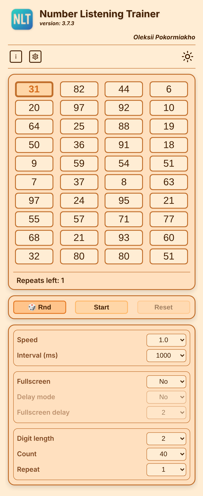

🌐 Idiomas disponíveis:  
[العربية](README.ar.md) | [Čeština](README.cs.md) | [Deutsch](README.de.md) | [English](README.en.md) | [Español](README.es.md) | [Français](README.fr.md) | [Italiano](README.it.md) | [Nederlands](README.nl.md) | [Polski](README.pl.md) | [Português](README.pt.md) | [Русский](README.ru.md) | [Türkçe](README.tr.md) | [Українська](README.uk.md)

---

# NLT Number Listening Trainer

Este é um aplicativo compacto, de página única, criado para aprender números em línguas estrangeiras.  
O aplicativo usa um método de percepção auditiva e visual simultânea, que permite memorizar de forma rápida e eficaz.

---

🌐 Idiomas disponíveis:  
[العربية](README.ar.md) | [Čeština](README.cs.md) | [Deutsch](README.de.md) | [English](README.en.md) | [Español](README.es.md) | [Français](README.fr.md) | [Italiano](README.it.md) | [Nederlands](README.nl.md) | [Polski](README.pl.md) | [Português](README.pt.md) | [Русский](README.ru.md) | [Türkçe](README.tr.md) | [Українська](README.uk.md)
